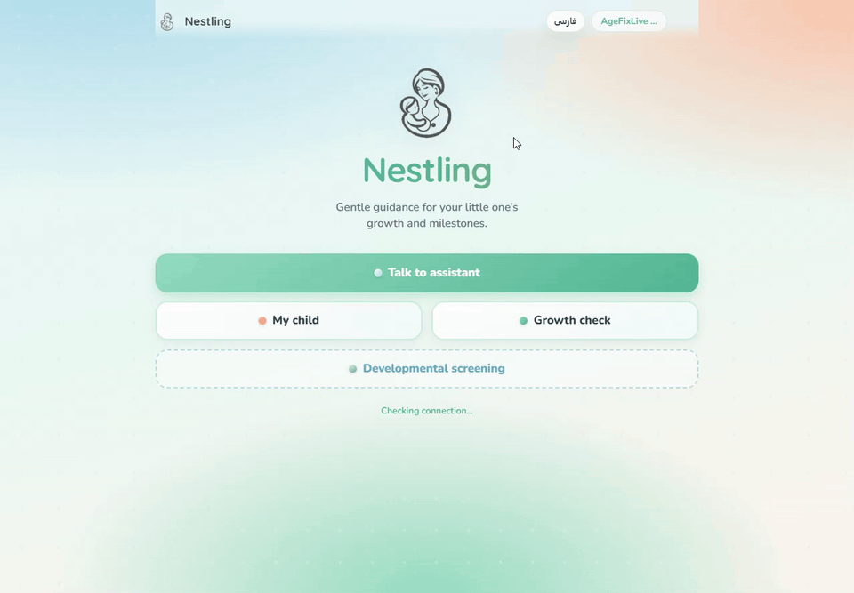

# Nestling

Nestling is a **parent-facing pediatric assistant**: growth charting (WHO term + INTERGROWTH preterm), age-aware feeding/sleep/iron/speech/skin/milestone guidance, and optional ASQ / M-CHAT screening helpers. The UI and API speak **English and Persian (FA)**. Growth numbers always come from deterministic clinical tools—not from the LLM.

## Demo



## Features

- **Growth tools** — percentiles / overlays for weight, length/height and head circumference; WHO (term) and INTERGROWTH (preterm PMA) routing. Numbers come from deterministic tools, never from the model.
- **Care library as skills** — guidelines, curated leaflets and two full WHO books (infant & young child feeding; pregnancy, childbirth, postpartum & newborn care) live as Markdown files under `knowledge/`. The agent opens them with `library.open`, which returns a short file whole and, for a long one, its outline plus the sections that match the question. Add a file and it is offered on the next turn; nothing is indexed by hand.
- **RLM orchestrator** — a TypeScript engine (`vendor/rlm-ide`) runs each turn as model steps plus a sandboxed Python REPL that executes ```` ```repl ```` cells and exposes the tools.
- **Age-aware reading** — the child's age is computed from the record; age-ranged sections that apply are named to the model, and library files written for another age band are set aside.
- **Plans and to-do lists** — a request with several parts is carried out as a plan on a task board: each part is read from its own file, ticked when done, and shown to the parent under the answer.
- **Auto-continuation** — a planned job that runs out of steps schedules a wake-up and continues in a new turn; the waiting request follows it to the end.
- **Memory** — short-term: the conversation, with finished turns folded and the session compacted to a checkpoint as it grows. Long-term: facts the parent states and tool findings (centiles, screening scores), distilled by the model into a JSON schema and stored per child.
- **Grounded replies** — every number in a reply must appear (with the same unit) in what the turn read, the record or the saved facts; unsupported sentences are dropped. A reply with nothing looked up is written only from the record, saved facts and conversation.
- **No hangs** — a stuck-step breaker, a cap on note-keeping steps, a new message pre-empts a running one, and an empty answer is never stored as one.
- **Bilingual** — English and Persian; the model writes the English gloss of a Persian message itself (no third-party translation call), and replies in the parent's language.
- **Screening helpers** — ASQ questionnaires by age and M-CHAT-R, with scoring.
- **Model** — `Qwen/Qwen3.5-2B` on a vLLM OpenAI-compatible server (constrained JSON output for routing). MiniCPM5-1B was measured and could not drive the agent reliably.

## Architecture

```
web/ (SPA) ──▶ FastAPI app (app/) :8000 ──▶ TypeScript RLM orchestrator :8120 ──▶ vLLM :8100
                 │  child DB, chat sessions,      │  router → engine → reply writer
                 │  long-term memory (sqlite)     │  task board, wake-ups, compaction
                 │                                ▼
                 │                       Python REPL kernel
                 └── clinical tools ◀──── (library.open, clinical.*, task.*)
                                           knowledge/ (Markdown library)
```

| Piece | Role |
|---|---|
| `app/` | FastAPI entry (`app.main`), routes, auth, SSE chat |
| `web/` | Parent SPA (chat, task board, charts, child dossier) |
| `assistant/rlm/` | Host for the orchestrator: memory, English gloss, clinical tool bridge |
| `assistant/tools/` | Deterministic growth + screening tools (`TOOL_SPECS`) |
| `vendor/rlm-ide/packages/core` | RLM engine: steps, REPL cells, compaction, task boards, wake-ups |
| `vendor/rlm-ide/packages/nestling` | Nestling server: router, library tool, catalog, reply writer |
| `prompts/nestling/` | Nestling prompts (system, router, checks), overlaid on the stock ones |
| `knowledge/` | The care library (guidelines, charts, screening, books) |

## Requirements

- **Docker** + Docker Compose (preferred path)
- **Python 3.12+** if running locally without Docker
- **GPU (optional)** — NVIDIA GPU + [NVIDIA Container Toolkit](https://docs.nvidia.com/datacenter/cloud-native/container-toolkit/latest/install-guide.html) for the `llm` profile; without a usable GPU, `deploy.sh` falls back to app-only mode: growth, screening and charts work, but chat needs the model

## Quick start

### App only (no LLM sidecar)

From the repo root (PowerShell or bash):

```bash
docker compose up --build -d nestling
```

- UI + API: [http://localhost:8000](http://localhost:8000)
- Health: [http://localhost:8000/api/health](http://localhost:8000/api/health)

Optional smoke scenarios inside the container:

```bash
docker compose exec nestling python docs/_e2e_docker_scenarios.py
```

### Full stack, one command (recommended)

On a fresh GPU host, `deploy.sh` does the whole thing unattended: installs Docker and the NVIDIA Container Toolkit if missing, reconciles the driver against the vLLM image, downloads the model, sizes the sidecar for the actual card, builds, and brings the stack up.

```bash
./deploy.sh --yes
```

It prints the generated web sign-in and the URLs when it finishes. Re-running is safe — completed steps are skipped.

The model is fetched from whichever source is reachable, tried in order: the Docker Hub registry, the Hugging Face Hub, then ModelScope (`--model-source auto`, the default). This matters on networks where the Hugging Face CDN is blocked — the deploy still finds the weights rather than failing. Pin one source with `--model-source hub|hf|ms`.

The sidecar is sized from the GPU, not from a fixed profile. The precision follows the card's compute capability — fp8 on Ada/Hopper, bf16 on Turing/Ampere — so the same command works on a 2080 Ti and an H100 without an edit. On a host with no usable GPU it deploys app-only (growth, screening and charts; chat needs a model) rather than failing.

### Full stack, manually

If the weights are already in the host Hugging Face cache (offline mount):

```bash
docker compose --profile llm up --build -d
docker compose --profile llm logs -f llm
```

- Nestling: `http://localhost:8080` (behind nginx) or `http://localhost:8000` (app direct)
- OpenAI-compatible API: `http://localhost:8001/v1`

Stop:

```bash
docker compose --profile llm down
```

Deeper Docker notes (GPU checks, weight download, fallbacks): **[docs/DOCKER.md](docs/DOCKER.md)**.

## Environment / settings

Canonical defaults live in [`assistant/settings.py`](assistant/settings.py) (Pydantic Settings; also reads `.env`). Compose overrides the important ones for containers.

| Variable | Typical / default | Purpose |
|---|---|---|
| `NESTLING_USE_LLM` | `1` (compose) | `0` = no model; chat replies are unavailable |
| `NESTLING_LLM_URL` | `http://llm:8000` | App → text LLM base URL |
| `NESTLING_VISION_LLM_URL` | `http://llm:8000` | Vision endpoint (same service by default) |
| `NESTLING_LLM_MODEL` | `Qwen/Qwen3.5-2B` | Served model name |
| `NESTLING_VISION_MODEL` | `Qwen/Qwen3.5-2B` | Vision model name |
| `NESTLING_LOAD_MODELS` | `0` | Do not load heavy local HF models in the app image |
| `NESTLING_EMBEDDING_MODEL` | `BAAI/bge-m3` | Embedding model for long-term memory recall (lexical fallback without it) |
| `NESTLING_API_KEY` | unset | If set, require `X-API-Key` or `Authorization: Bearer` (health stays open) |
| `NESTLING_CORS_ORIGINS` | `*` | Comma-separated origins |
| `NESTLING_HF_CACHE_HOST` | `C:/Users/mhf/.cache/huggingface` | Host HF cache mounted into `llm` (read-only) |
| `NESTLING_LLM_USE_MODEL_ID` | `0` (`llm` service) | `0` = local snapshot path (offline); `1` = HF model id |
| `HF_HUB_OFFLINE` / `TRANSFORMERS_OFFLINE` | `1` on `llm` | Keep the model load offline from cache |

vLLM knobs (`VLLM_MAX_MODEL_LEN`, `VLLM_MAX_NUM_SEQS`, `VLLM_QUANTIZATION`, `VLLM_KV_CACHE_DTYPE`, …) are **derived from the GPU** by `scripts/size_llm.py` during `deploy.sh` and written to `.env`; the compose defaults are the fallback when that has not run. See [docs/PERFORMANCE.md](docs/PERFORMANCE.md) for how they are computed.

## LLM notes

- Single sidecar: **Qwen/Qwen3.5-2B** on vLLM (`docker/llm/`), profile name `llm`.
- App talks to it over the Docker network (`http://llm:8000`); host maps **8001 → 8000**.
- Every chat turn runs on the model. If the sidecar is down or `NESTLING_USE_LLM=0`, chat says it cannot answer; growth, screening and charts keep working.
- Vision shares the same endpoint; if the stack cannot do images, `/api/chat/vision` still returns guidance with a fallback `mode` (see Docker doc).

## API / UI

Base URL: `http://localhost:8000`

| Method | Path | Notes |
|---|---|---|
| GET | `/api/health` | Liveness + short LLM readiness probe |
| POST | `/api/chat` | Full chat turn (JSON body: `message`, optional `session_id`, `child_id`, `ui_lang`) |
| POST | `/api/chat/stream` | SSE: `token` chunks, then `result`, then `done` |
| POST | `/api/chat/vision` | multipart: `image` + optional `message` / session / child / `ui_lang` |
| POST/GET | `/api/children`, `/api/children/{id}`, `/dossier` | Child CRUD + dossier |
| POST/GET | `/api/sessions`, `/api/sessions/{id}` | Chat sessions + history |
| POST | `/api/growth` | Record / overlay growth point |
| GET | `/api/growth/curves` | Percentile curve JSON for SVG charts |
| GET/POST | `/api/asq/...`, `/api/mchat/...` | Screening questions + scores |
| GET | `/api/overlays/{filename}` | Chart overlay PNGs |

Example chat (PowerShell):

```powershell
Invoke-RestMethod -Method Post -Uri http://localhost:8000/api/chat `
  -ContentType "application/json" `
  -Body '{"message":"My baby is 4 months. What about iron?","ui_lang":"en"}'
```

OpenAPI docs (when running): `http://localhost:8000/docs`.

## Clinical safety

- **Growth math and screening scores are deterministic tools** (WHO LMS / INTERGROWTH equations, ASQ/M-CHAT config). The LLM must not invent percentiles or scores.
- Answers are **educational guidance for parents**, not diagnosis or emergency triage.
- Age-based care (feeding, sleep, milestones) uses **chronological age**; preterm charting may still use PMA on INTERGROWTH charts when that standard applies.
- Always seek professional care for red-flag symptoms (breathing trouble, lethargy, rapidly spreading infection signs, etc.).

## Tests

From the repo root (local venv with `requirements-core.txt` or inside the container):

```bash
# Fast, high-signal subset
python -m pytest tests/test_chat_stream.py tests/test_clinical_guards.py tests/test_size_llm.py -q

# Broader clinical
python -m pytest tests/test_equations_accuracy.py tests/test_growth_curves.py tests/test_tools_robust.py -q

# Orchestrator (TypeScript)
cd vendor/rlm-ide && npx vitest run

# Full suite (slower; some tests may need Docker/live services)
python -m pytest tests -q
```

Inside Docker:

```bash
docker compose exec nestling python -m pytest tests/test_router.py tests/test_medical_age.py tests/test_chat_stream.py -q
```

## Development notes

- Default app image installs **`requirements-core.txt`** only (no full torch tool-calling stack). Set Docker build-arg `INSTALL_ML=1` for the optional HF tool model.
- Compose bind-mounts `assistant/`, `app/`, `web/`, `tests/`, etc., so code edits apply without rebuilding the app image (restart may still be needed).
- Named volumes hold children DB, overlays, uploads, knowledge index, and app HF cache; entrypoint seeds/rebuilds knowledge when the volume is empty or stale.
- Intent patterns: `config/intent_rules.yaml` + `assistant/agent/intents.py` / `router.py`.
- Settings: prefer changing env or `assistant/settings.py` rather than hardcoding URLs in routes.

## Docs

- **[docs/DOCKER.md](docs/DOCKER.md)** — GPU, HF cache, env table, LLM fallback behavior
